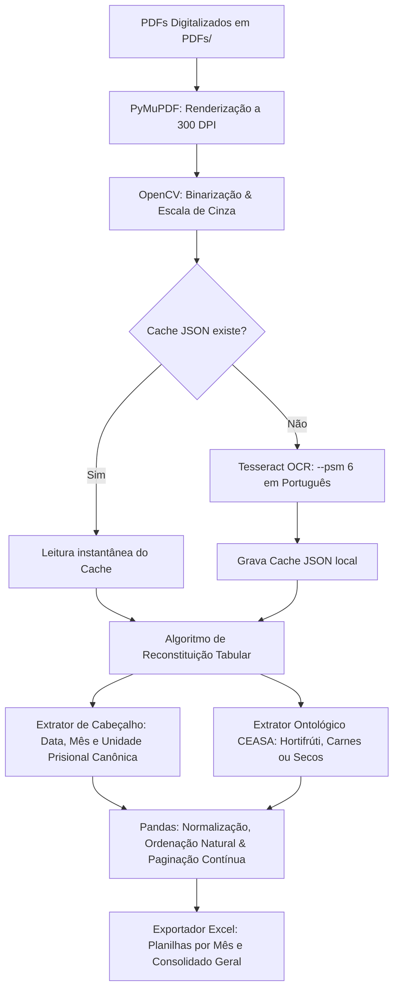

# 🥑 Pipeline de Extração Automatizada de Alimentos (CANE)

> **Automação em Python com Visão Computacional e OCR para extração, estruturação e auditoria de guias de entrega de alimentos no sistema prisional.**

---

## 🏢 1. O Problema de Negócio

O setor parceiro **CANE** (Coordenadoria de Alimentação e Nutrição) é responsável pela gestão, planejamento e auditoria dos suprimentos alimentícios fornecidos aos estabelecimentos prisionais de Pernambuco (SERES-PE).

### A Dor Operacional:
* **Informações Presas em Documentos:** Fornecedores e centrais de distribuição (como a CEASA) emitem centenas de comprovantes de entrega e guias de remessa em formato **PDF digitalizado (scans físicos)** e vetorial, sem padronização tabular direta.
* **Inviabilidade Manual:** Para conferir o cumprimento contratual, a equipe precisava abrir documento por documento, transcrever manualmente para planilhas cada item entregue, a unidade recebedora, a data e as quantidades.
* **Gargalo de Auditoria:** Esse processo manual demandava semanas de trabalho repetitivo, gerava alto risco de erro humano e impedia respostas rápidas em fiscalizações orçamentárias e contratos públicos.

---

## 💡 2. A Solução Desenvolvida

Para solucionar esse gargalo, foi construída uma **arquitetura de pipelines especializados em Python** que processa em lote (*batch processing*) centenas de documentos PDF, extrai os metadados críticos por meio de técnicas avançadas de Visão Computacional e OCR, e entrega **planilhas Excel consolidadas, padronizadas e auditáveis** por categoria contratual.

### Principais Benefícios:
* ⚡ **Redução Drástica de Tempo:** Processamento de meses inteiros de notas fiscais e guias de entrega em poucos minutos.
* 🎯 **Precisão & Rastreabilidade:** Cada registro na planilha final indica o arquivo original e o número exato da página contínua de onde o dado foi extraído.
* 🏛️ **Ontologia Canônica:** Normalização para as 23 Unidades Prisionais Oficiais de Pernambuco, expurgando ruídos de inscrições fiscais (`LF:`, `CNPJ`, `ISENTO`).
* 🛡️ **Idempotência com Cache:** Sistema de cache baseado em hash MD5 que armazena os resultados do OCR localmente em JSON, eliminando retrabalho de CPU caso o pipeline precise ser reexecutado.

---

## ⚙️ 3. Arquitetura & Fluxo de Processamento



---

## 📂 4. Estrutura do Repositório

```text
extrator_pdf/
│
├── src/                          # Código-fonte da automação
│   ├── main.py                   # Ponto de entrada para Hortifrúti / Alimentos Gerais
│   ├── extrator_perecivel.py     # Pipeline especializado em Carnes, Frios e Proteínas
│   ├── extrator_nao_perecivel.py # Pipeline especializado em Alimentos Secos e Mercearia
│   ├── comparar.py               # Script de auditoria e validação com gabarito histórico
│   │
│   ├── config/                   # Configurações do ambiente e constantes
│   │   ├── __init__.py
│   │   └── settings.py           # Paths, tolerância de OCR, DPI e catálogo de itens
│   │
│   ├── extractors/               # Módulos de extração de entidades
│   │   ├── __init__.py
│   │   ├── header_extractor.py   # Extração de presídio, data e competência
│   │   └── product_extractor.py  # Mapeamento e delimitação geométrica de produtos
│   │
│   └── utils/                    # Utilitários compartilhados
│       ├── __init__.py
│       ├── excel_exporter.py     # Formatação de larguras e estilos do Excel
│       ├── pdf_organizer.py      # Classificação e movimentação automática de PDFs
│       └── text_cleaner.py       # Regex e normalização de texto
│
├── .gitignore                    # Regras para ignorar dados brutos, caches e saídas
├── requirements.txt              # Dependências do projeto
└── README.md                     # Documentação da solução
```

> **Nota de Segurança:** As pastas de dados brutos (`PDFs/`), arquivos de cache (`cache_ocr_*/`) e saídas geradas (`planilhas_saida/`) não são versionadas no Git para manter o repositório leve e proteger dados sensíveis.

---

## 📊 5. Estrutura dos Dados Exportados

As planilhas geradas em `planilhas_saida/ceasa/` contêm o seguinte esquema de colunas:

| Coluna | Descrição | Exemplo |
| :--- | :--- | :--- |
| `arquivo` | Nome do PDF original rastreado | `12533.pdf` |
| `pagina` | Número sequencial cumulativo no lote | `1` |
| `lugar` | Unidade prisional oficial SERES-PE | `CPFR - COLÔNIA PENAL FEMININA DO RECIFE` |
| `produto` | Item alimentício padronizado | `CARNE BOVINA SALGADA CURADA DESSECADA KG` |
| `data` | Data de emissão/entrega | `30/12/2025` |
| `mes` | Mês de competência da entrega | `12` |

---

## 🚀 6. Como Executar os Pipelines

### Pré-requisitos:
1. **Python 3.10+** instalado.
2. **Tesseract OCR** instalado no sistema (em Windows: `C:\Program Files\Tesseract-OCR\tesseract.exe`).

### 1. Clonar o Repositório e Instalar Dependências:
```bash
git clone https://github.com/LouisLuos/extrator-de-PDF.git
cd extrator-de-PDF
python -m venv venv
venv\Scripts\activate   # No Linux/Mac: source venv/bin/activate
pip install -r requirements.txt
```

### 2. Executar as Extrações por Categoria:

* **Para Hortifrúti e Alimentos Gerais:**
  ```bash
  python src/main.py
  ```
  *Saídas em:* `planilhas_saida/ceasa/hortifrute/`

* **Para Alimentos Perecíveis (Carnes, Frios e Proteínas):**
  ```bash
  python src/extrator_perecivel.py
  ```
  *Saídas em:* `planilhas_saida/ceasa/perecivel/`

* **Para Alimentos Não Perecíveis (Secos e Mercearia):**
  ```bash
  python src/extrator_nao_perecivel.py
  ```
  *Saídas em:* `planilhas_saida/ceasa/nao_perecivel/`

* **Para Auditoria e Validação Comparativa:**
  ```bash
  python src/comparar.py
  ```

---

## 📈 7. Impacto e Resultados Auditados

| Categoria | Pasta de Saída | Total de PDFs | Total de Registros | Taxa de Preenchimento |
|---|---|:---:|:---:|:---:|
| 🥬 **Hortifrúti** | `planilhas_saida/ceasa/hortifrute/` | 381 | **4.125 linhas** | **100,0%** (0 nulos) |
| 🥩 **Perecíveis** | `planilhas_saida/ceasa/perecivel/` | 319 | **1.957 linhas** | **100,0%** (0 nulos) |
| 📦 **Não Perecíveis** | `planilhas_saida/ceasa/nao_perecivel/` | 196 | **2.894 linhas** | **100,0%** (0 nulos) |
| **TOTAL GERAL** | | **896 PDFs** | **8.976 linhas** | 🚀 **100,0% Concluído** |
