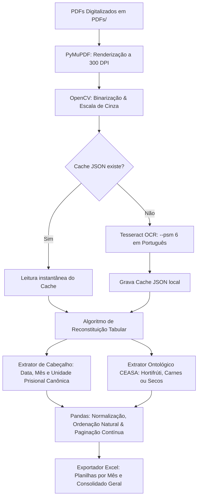

# 🥑 Pipeline de Extração Automatizada de Alimentos (CANE)

> **Automação em Python com Visão Computacional e OCR para extração, estruturação e auditoria de guias de entrega de alimentos no sistema prisional.**

> [!TIP]
> **É usuária(o) final e só quer usar o sistema?** Vá direto para a seção [👩‍💼 7. Como Usar no Dia a Dia](#-7-como-usar-no-dia-a-dia-usuária-final).
> **Vai instalar em um computador novo?** Siga a seção [🖥️ 6. Instalação em um Computador Novo](#️-6-instalação-em-um-computador-novo).

---

## 🏢 1. O Problema de Negócio

O setor parceiro **CANE** (Coordenadoria de Alimentação e Nutrição) é responsável pela gestão, planejamento e auditoria dos suprimentos alimentícios fornecidos aos estabelecimentos prisionais de Pernambuco (SERES-PE).

### A Dor Operacional:
* **Informações Presas em Documentos:** Fornecedores e centrais de distribuição (como a CEASA) emitem centenas de comprovantes de entrega e guias de remessa em formato **PDF digitalizado (scans físicos)** e vetorial, sem padronização tabular direta.
* **Inviabilidade Manual:** Para conferir o cumprimento contratual, a equipe precisava abrir documento por documento, transcrever manualmente para planilhas cada item entregue, a unidade recebedora, a data e as quantidades.
* **Gargalo de Auditoria:** Esse processo manual demandava semanas de trabalho repetitivo, gerava alto risco de erro humano e impedia respostas rápidas em fiscalizações orçamentárias e contratos públicos.

---

## 💡 2. A Solução Desenvolvida

Para solucionar esse gargalo, foi construída uma **arquitetura de pipelines especializados em Python** que processa em lote (*batch processing*) centenas de documentos PDF, extrai os metadados críticos por meio de técnicas avançadas de Visão Computacional e OCR, e entrega **planilhas Excel consolidadas, padronizadas e auditáveis** por categoria contratual.

O sistema pode ser usado de duas formas:

| Modo | Para quem | Como inicia |
|---|---|---|
| 🌐 **Interface Web** | Usuárias(os) do setor, sem conhecimento técnico | Duplo clique em `iniciar_extrator.bat` |
| ⌨️ **Linha de comando** | Equipe técnica, processamento de lotes históricos | `python src/main.py` (e similares) |

### Principais Benefícios:
* ⚡ **Redução Drástica de Tempo:** Processamento de meses inteiros de notas fiscais e guias de entrega em poucos minutos.
* 🎯 **Precisão & Rastreabilidade:** Cada registro na planilha final indica o arquivo original e o número exato da página contínua de onde o dado foi extraído.
* 🏛️ **Ontologia Canônica:** Normalização para as 23 Unidades Prisionais Oficiais de Pernambuco, expurgando ruídos de inscrições fiscais (`LF:`, `CNPJ`, `ISENTO`).
* 🛡️ **Idempotência com Cache:** Sistema de cache baseado em hash MD5 que armazena os resultados do OCR localmente em JSON, eliminando retrabalho de CPU caso o pipeline precise ser reexecutado.

---

## ⚙️ 3. Arquitetura & Fluxo de Processamento



---

## 📂 4. Estrutura do Repositório

```text
extrator_pdf/
│
├── iniciar_extrator.bat          # ▶️ ATALHO DA USUÁRIA: inicia a interface web com 1 clique
├── app.py                        # Servidor web local (Flask) usado pelo .bat
├── templates/
│   └── index.html                # Tela da interface web (upload, progresso, download)
│
├── src/                          # Código-fonte da automação
│   ├── main.py                   # Ponto de entrada para Hortifrúti / Alimentos Gerais
│   ├── extrator_perecivel.py     # Pipeline especializado em Carnes, Frios e Proteínas
│   ├── extrator_nao_perecivel.py # Pipeline especializado em Alimentos Secos e Mercearia
│   ├── fila_execucao.py          # Orquestrador que executa pipelines em sequência
│   ├── comparar.py               # Script de auditoria e validação com gabarito histórico
│   │
│   ├── config/                   # Configurações do ambiente e constantes
│   │   ├── __init__.py
│   │   └── settings.py           # Paths, tolerância de OCR, DPI e catálogo de itens
│   │
│   ├── extractors/               # Módulos de extração de entidades
│   │   ├── __init__.py
│   │   ├── header_extractor.py   # Extração de presídio, data e competência
│   │   └── product_extractor.py  # Mapeamento e delimitação geométrica de produtos
│   │
│   └── utils/                    # Utilitários compartilhados
│       ├── __init__.py
│       ├── excel_exporter.py     # Formatação de larguras e estilos do Excel
│       ├── pdf_organizer.py      # Classificação e movimentação automática de PDFs
│       └── text_cleaner.py       # Regex e normalização de texto
│
├── tests/                        # Testes automatizados (pytest)
├── .gitattributes                # Garante quebra de linha CRLF no .bat (obrigatório no Windows)
├── .gitignore                    # Regras para ignorar dados brutos, caches e saídas
├── requirements.txt              # Dependências do projeto
└── README.md                     # Documentação da solução
```

> **Nota de Segurança:** As pastas de dados brutos (`PDFs/`), arquivos de cache (`cache_ocr_*/`) e saídas geradas (`planilhas_saida/`) não são versionadas no Git para manter o repositório leve e proteger dados sensíveis.

---

## 📊 5. Estrutura dos Dados Exportados

### 5.1 Planilha da Interface Web (1 linha por guia)

Gerada em `planilhas_saida/web/guias_consolidadas_AAAAMMDD_HHMMSS.xlsx` e também baixada pelo navegador.

| Coluna | Descrição | Exemplo |
| :--- | :--- | :--- |
| `arquivo` | Nome do PDF enviado (com `[Guia N]` se o PDF tiver várias guias) | `12543.pdf` |
| `pagina` | Número sequencial da guia no lote | `1` |
| `lugar` | Unidade prisional oficial SERES-PE | `PFDB - PRESÍDIO FREI DAMIÃO DE BOZZANO` |
| `data` | Data de emissão/entrega | `30/12/2025` |
| `mes` | Mês de competência da entrega | `12` |
| `reposicao` | Indica se a guia é de reposição | `SIM` / `NAO` |

### 5.2 Planilhas dos Pipelines de Linha de Comando (1 linha por produto)

As planilhas geradas em `planilhas_saida/ceasa/` contêm o seguinte esquema de colunas:

| Coluna | Descrição | Exemplo |
| :--- | :--- | :--- |
| `arquivo` | Nome do PDF original rastreado | `12533.pdf` |
| `pagina` | Número sequencial cumulativo no lote | `1` |
| `lugar` | Unidade prisional oficial SERES-PE | `CPFR - COLÔNIA PENAL FEMININA DO RECIFE` |
| `produto` | Item alimentício padronizado | `CARNE BOVINA SALGADA CURADA DESSECADA KG` |
| `data` | Data de emissão/entrega | `30/12/2025` |
| `mes` | Mês de competência da entrega | `12` |

---

## 🖥️ 6. Instalação em um Computador Novo

> Este passo a passo é feito **uma única vez** por quem está instalando (equipe técnica). Tempo estimado: **15 a 20 minutos**.

### ✅ Checklist rápido

- [ ] Python instalado **com "Add Python to PATH" marcado**
- [ ] Tesseract OCR instalado **com o idioma Português**
- [ ] Pasta do extrator copiada para o computador
- [ ] Primeira execução feita **com internet** (instala as bibliotecas)
- [ ] Atalho criado na Área de Trabalho
- [ ] Teste com 1 PDF real concluído

### Passo 1 — Instalar o Python

1. Baixe o Python **3.10 ou superior** em: <https://www.python.org/downloads/windows/>
2. Execute o instalador.
3. ⚠️ **Na primeira tela, MARQUE a caixa `Add python.exe to PATH`** antes de clicar em *Install Now*.

> [!WARNING]
> Se essa caixa não for marcada, o `.bat` não encontrará o Python (ou abrirá a Microsoft Store). Nesse caso, desinstale e instale novamente marcando a opção.

### Passo 2 — Instalar o Tesseract OCR (leitor de PDFs escaneados)

1. Baixe o instalador para Windows em: <https://github.com/UB-Mannheim/tesseract/wiki> (arquivo `tesseract-ocr-w64-setup-*.exe`).
2. Durante a instalação, na tela **"Choose Components"**:
   - Expanda **`Additional language data (download)`**
   - ⚠️ **Marque `Portuguese`**
3. Mantenha a pasta padrão: `C:\Program Files\Tesseract-OCR`.

> [!IMPORTANT]
> Sem o idioma **Portuguese**, o sistema até abre, mas **não consegue ler PDFs escaneados** (só os PDFs digitais/vetoriais).

**Como conferir:** abra o *Prompt de Comando* e digite:
```bat
"C:\Program Files\Tesseract-OCR\tesseract.exe" --list-langs
```
A lista deve conter `por`.

### Passo 3 — Copiar a pasta do sistema

Copie a pasta `extrator_pdf` para um local fixo do computador da usuária, por exemplo:
```text
C:\Users\<nome_da_usuaria>\Documents\extrator_pdf
```

**Itens obrigatórios** na pasta copiada:

```text
extrator_pdf/
├── iniciar_extrator.bat
├── app.py
├── requirements.txt
├── src/          (pasta inteira)
└── templates/    (pasta inteira)
```

**Não é necessário copiar:** `PDFs/`, `PDFs_organizados/`, `cache_ocr*/`, `planilhas_saida/`, `tests/`, `.git/`, `__pycache__/`, `.pytest_cache/` e arquivos `.log`.

> [!CAUTION]
> Copie a pasta por **pendrive, rede ou ZIP gerado no Windows**. Não abra e salve o `iniciar_extrator.bat` em editores que convertam as quebras de linha para o formato Linux (LF) — isso **quebra o arquivo** (erro `'cho' não é reconhecido...`). O `.bat` precisa estar em **CRLF**.

### Passo 4 — Primeira execução (com internet)

1. Dê **duplo clique** em `iniciar_extrator.bat`.
2. Na primeira vez, a etapa `[3/4] Verificando dependencias necessarias...` baixa as bibliotecas Python e **pode levar alguns minutos**. Aguarde.
3. O navegador abrirá automaticamente em `http://127.0.0.1:5000`.

> [!NOTE]
> Nas próximas execuções essa etapa leva poucos segundos. Se o computador estiver sem internet depois, o sistema exibe um aviso e **inicia normalmente** com as bibliotecas já instaladas.

### Passo 5 — Criar o atalho na Área de Trabalho

1. Clique com o botão direito em `iniciar_extrator.bat` → **Mostrar mais opções** → **Enviar para** → **Área de trabalho (criar atalho)**.
2. (Opcional) Renomeie o atalho para **"Extrator de Guias"**.
3. (Opcional) Botão direito no atalho → **Propriedades** → **Alterar ícone** para escolher um ícone mais amigável.

### Passo 6 — Teste de aceite com a usuária

Faça um teste junto com ela usando **1 ou 2 PDFs reais** e confira se a unidade prisional e a data na tabela batem com o documento. Isso valida a instalação ponta a ponta (Python + Tesseract + bibliotecas).

---

## 👩‍💼 7. Como Usar no Dia a Dia (Usuária Final)

### ▶️ Abrir o sistema

1. Dê **duplo clique** no atalho **"Extrator de Guias"** na Área de Trabalho.
2. Uma **janela preta** vai abrir e mostrar algumas verificações. ⚠️ **Não feche essa janela** — ela é o "motor" do sistema.
3. Em alguns segundos o **navegador abre sozinho** com a tela do Extrator.
   - Se não abrir, digite no navegador: **`http://127.0.0.1:5000`**

### 📄 Processar as guias

1. **Envie os PDFs** de uma destas formas:
   - **Arraste** os arquivos PDF para a área *"Arraste seus PDFs aqui"*; ou
   - Clique em **"Selecionar Arquivos"** para escolher um ou vários PDFs; ou
   - Clique em **"Selecionar Pasta Inteira"** para enviar todos os PDFs de uma pasta.
2. Confira a lista de arquivos carregados. Se errar, clique em **"Limpar"** e comece de novo.
3. Em **"Categoria Operacional"**, deixe em **🤖 Identificação Automática** (recomendado) ou escolha a categoria das guias.
4. Clique em **"Processar Guias"** e acompanhe a barra de progresso.
   - PDFs escaneados demoram mais (alguns segundos por página). PDFs já processados antes são **instantâneos**, graças ao cache.

### 📊 Conferir e baixar o resultado

1. Ao final, aparecem os **indicadores** (total de guias, regulares e reposições) e a **tabela de pré-visualização**.
2. Clique em **"Baixar Planilha Excel (.xlsx)"**. O arquivo vai para a pasta **Downloads**.
3. Uma cópia de segurança também fica salva em `extrator_pdf\planilhas_saida\web\`.

> [!TIP]
> Se aparecer **"NÃO IDENTIFICADO"** ou **"N/A"** em alguma linha, confira aquele PDF manualmente — geralmente é uma digitalização com baixa qualidade, torta ou cortada.

### ⏹️ Fechar o sistema

Quando terminar, **feche a janela preta** (no **X**) ou pressione **Ctrl + C** dentro dela. Fechar só o navegador **não** encerra o sistema.

---

## 🩺 8. Problemas Comuns e Soluções

| O que aparece | Causa provável | Como resolver |
|---|---|---|
| `[ERRO] Python nao encontrado no PATH` | Python não instalado ou sem "Add to PATH" | Reinstalar o Python marcando **Add python.exe to PATH** (Passo 1) |
| Abre a **Microsoft Store** ao iniciar | Atalho falso do Python do Windows | Configurações → Aplicativos → **Aliases de execução de aplicativo** → desativar `python.exe` e `python3.exe`; depois instalar o Python oficial |
| `[AVISO IMPORTANTE] Motor Tesseract OCR nao detectado` | Tesseract não instalado | Instalar o Tesseract (Passo 2) |
| Guias escaneadas saem com **"NÃO IDENTIFICADO"** em todas as linhas | Tesseract sem idioma Português | Reinstalar o Tesseract marcando **Portuguese** (Passo 2) |
| `'cho' não é reconhecido como um comando...` | O `.bat` perdeu o formato CRLF | Copiar novamente o `iniciar_extrator.bat` original (ver aviso do Passo 3) |
| `[AVISO] Nao foi possivel instalar/atualizar as dependencias` | Sem internet ou proxy bloqueando | Na **primeira** instalação é obrigatório ter internet; pedir liberação ao TI se houver proxy |
| Navegador mostra **"Não é possível acessar esse site"** | A janela preta foi fechada ou ainda está iniciando | Aguardar alguns segundos e atualizar (F5); se necessário, abrir o atalho de novo |
| Windows mostra **"O Windows protegeu o computador"** | SmartScreen bloqueando o `.bat` | Clicar em **Mais informações** → **Executar assim mesmo** |
| Erro ao processar ou janela fecha sozinha | Erro inesperado | Tirar um **print da janela preta** e enviar para o suporte técnico |

### 🧹 Manutenção

- As pastas `cache_ocr_perecivel/`, `cache_ocr/` e `cache_ocr_nao_perecivel/` aceleram reprocessamentos. Se ficarem grandes demais, **podem ser apagadas** com o sistema fechado — serão recriadas automaticamente.
- Planilhas antigas em `planilhas_saida/web/` podem ser apagadas ou arquivadas periodicamente.

---

## ⌨️ 9. Pipelines por Linha de Comando (Equipe Técnica)

### Pré-requisitos:
1. **Python 3.10+** instalado.
2. **Tesseract OCR** instalado no sistema (em Windows: `C:\Program Files\Tesseract-OCR\tesseract.exe`).

### 1. Clonar o Repositório e Instalar Dependências:
```bash
git clone https://github.com/LouisLuos/extrator-de-PDF.git
cd extrator-de-PDF
python -m venv venv
venv\Scripts\activate   # No Linux/Mac: source venv/bin/activate
pip install -r requirements.txt
```

### 2. Executar as Extrações por Categoria:

* **Para Hortifrúti e Alimentos Gerais:**
  ```bash
  python src/main.py
  ```
  *Saídas em:* `planilhas_saida/ceasa/hortifrute/`

* **Para Alimentos Perecíveis (Carnes, Frios e Proteínas):**
  ```bash
  python src/extrator_perecivel.py
  ```
  *Saídas em:* `planilhas_saida/ceasa/perecivel/`

* **Para Alimentos Não Perecíveis (Secos e Mercearia):**
  ```bash
  python src/extrator_nao_perecivel.py
  ```
  *Saídas em:* `planilhas_saida/ceasa/nao_perecivel/`

* **Para Auditoria e Validação Comparativa:**
  ```bash
  python src/comparar.py
  ```

### 3. Executar os Testes Automatizados:
```bash
python -m pytest tests -q
```

> [!NOTE]
> Alguns testes (ex.: `test_multi_guia_segmentation`) usam PDFs reais da pasta `PDFs/`, que não é versionada. Em uma máquina sem esses arquivos, esses testes vão falhar.

---

## 📈 10. Impacto e Resultados Auditados

| Categoria | Pasta de Saída | Total de PDFs | Total de Registros | Taxa de Preenchimento |
|---|---|:---:|:---:|:---:|
| 🥬 **Hortifrúti** | `planilhas_saida/ceasa/hortifrute/` | 381 | **4.125 linhas** | **100,0%** (0 nulos) |
| 🥩 **Perecíveis** | `planilhas_saida/ceasa/perecivel/` | 319 | **1.957 linhas** | **100,0%** (0 nulos) |
| 📦 **Não Perecíveis** | `planilhas_saida/ceasa/nao_perecivel/` | 196 | **2.894 linhas** | **100,0%** (0 nulos) |
| **TOTAL GERAL** | | **896 PDFs** | **8.976 linhas** | 🚀 **100,0% Concluído** |
